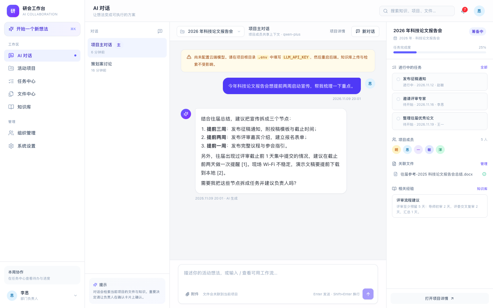
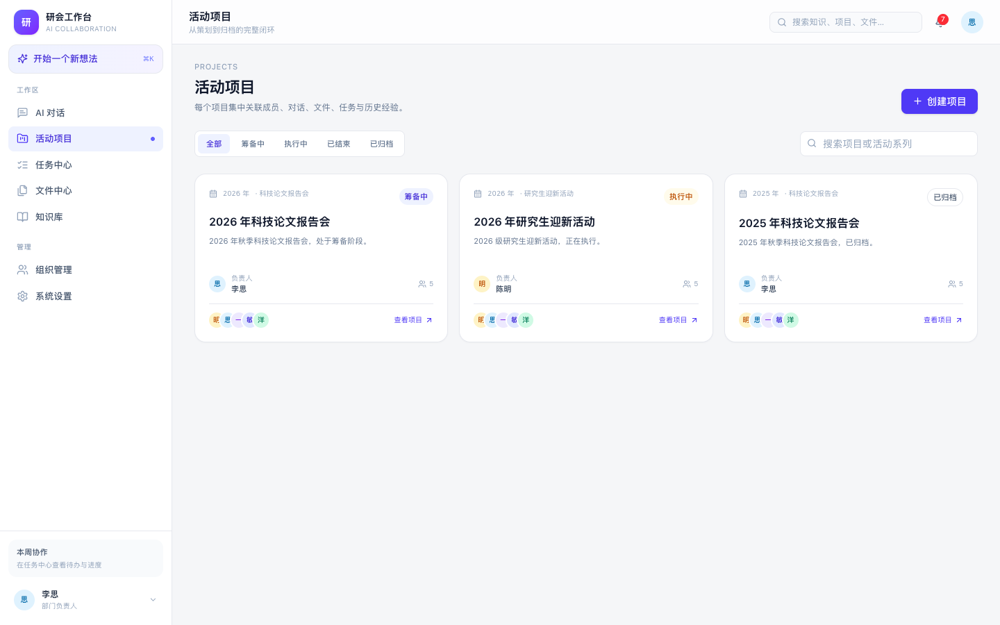
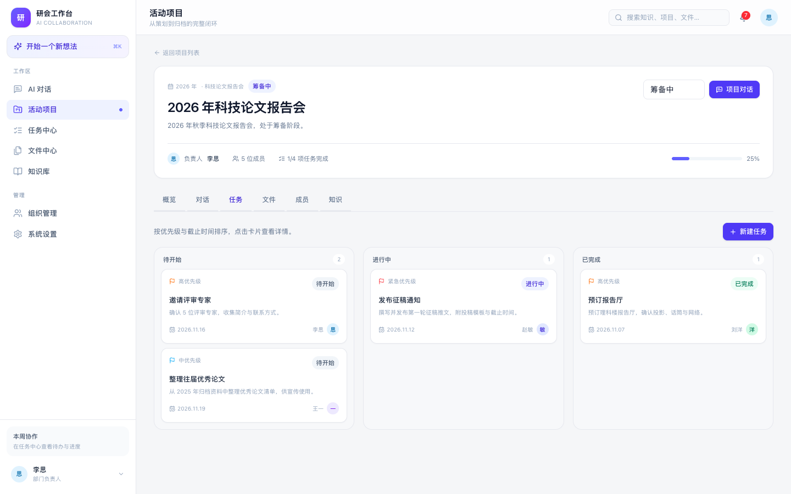
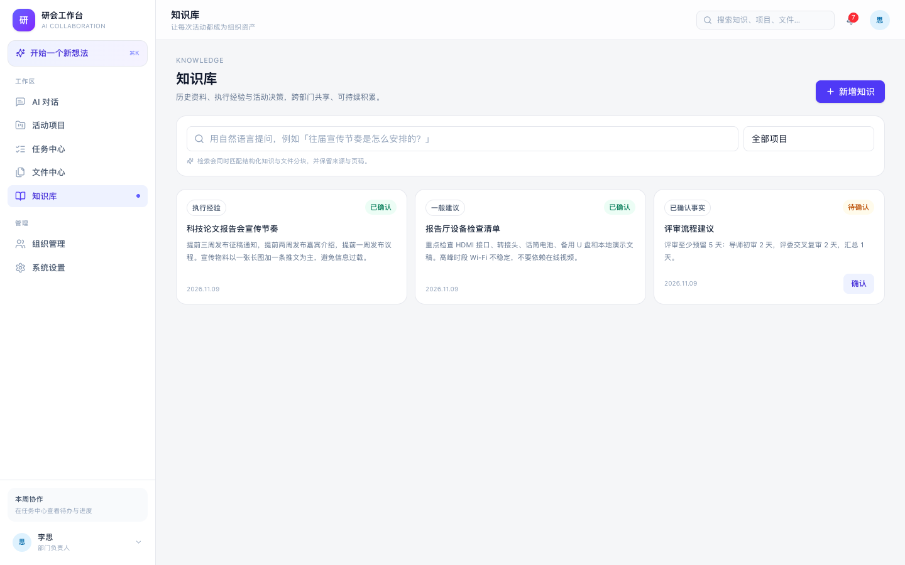
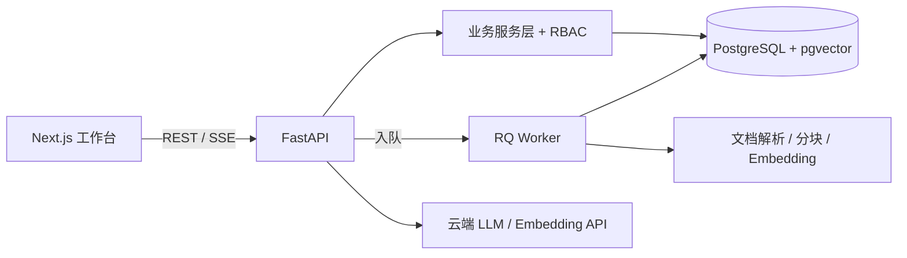

# 研究生会 AI 协同工作台


> 仓库：<https://github.com/Amaterasu-kura/research-union-workbench>
> 当前状态：Phase 1 核心闭环已完成（AI 对话需配置云端模型 Key）。

面向高校研究生会的 AI 协同工作台：把活动想法、历史资料、项目对话、策划文件、任务分工与执行经验放在同一个系统里，让每次活动都成为组织可以继续使用的资产。

当前版本完成 **Phase 1 核心闭环**：登录与角色、三栏工作台、全局/项目对话、项目创建与确认、项目成员、文件上传与解析、基础知识库检索、任务创建/分配/状态/交换。Phase 2 将接入 LangGraph 编排、Word 策划案生成与知识自动提取。

技术选型依据见 [技术选型报告](docs/技术选型报告.md)，Phase 1 完成情况见 [阶段一说明](docs/Phase1-完成情况.md)。

## 目录

- [界面预览](#界面预览)
- [1. 技术栈](#1-技术栈)
- [2. 功能概览](#2-功能概览)
- [3. 架构](#3-架构)
- [4. 目录结构](#4-目录结构)
- [5. 本机开发](#5-本机开发macos--apple-silicon)
- [6. 环境变量](#6-环境变量)
- [7. Docker Compose 部署](#7-docker-compose-部署)
- [8. 主要 API](#8-主要-api)
- [9. 数据库](#9-数据库)
- [10. 测试与质量](#10-测试与质量)
- [11. 已知限制](#11-已知限制)
- [12. 开发约定](#12-开发约定)
- [13. 许可与贡献](#13-许可与贡献)

## 界面预览

| 项目对话 | 活动项目 |
|---|---|
|  |  |

| 任务看板 | 知识库 |
|---|---|
|  |  |

更多截图见 [docs/screenshots](docs/screenshots)。

---

## 1. 技术栈

| 层 | 选型 |
|---|---|
| 前端 | Next.js 16（App Router）+ React 19 + Tailwind CSS 4 + shadcn 风格组件 |
| 后端 | FastAPI + SQLAlchemy 2 + Alembic + Pydantic |
| 数据库 | PostgreSQL 17 + pgvector（单库同时存业务数据与向量索引） |
| 队列 | Redis + RQ（文件解析、分块、Embedding） |
| 文档 | PyMuPDF（PDF）、python-docx（Word）、jieba（中文分词） |
| 模型 | OpenAI 兼容接口：Qwen `qwen-plus` + `text-embedding-v4`（1024 维） |
| 部署 | Docker Compose + Caddy（本机开发也支持原生 Homebrew 服务） |

**核心设计：业务主数据只有一套 PostgreSQL。** 对话、项目、文件、任务、知识、Agent 执行记录共享同一套 UUID 主键、RBAC 与软删除；不引入第二套用户/知识库/会话系统。

---

## 2. 功能概览

### 已实现

- **账号与角色**：主席团 / 部门负责人 / 普通部员；HttpOnly JWT Cookie；后端权限校验。
- **三栏工作台**：左侧系统导航 + 对话列表，中间工作区，右侧项目上下文（任务/成员/文件/经验）。
- **AI 对话**：全局私人对话、项目内多对话、项目主对话；自动检索项目资料；**创建项目必须经负责人确认**。
- **活动项目**：EventSeries + Project 两层；筹备中/执行中/已结束/已归档；普通成员可提交项目创建申请，负责人/主席团确认后创建；成员可申请加入并由负责人审核。
- **文件与知识**：Word/PDF/文本/图片上传；异步解析、结构感知分块、中文关键词检索；pgvector 向量检索接口已就绪；引用保留文件名与页码。
- **任务**：创建、优先级、截止时间、负责人、状态流转、任务历史、任务交换（双方确认）。
- **通知**：任务分配、成员审核、交换申请等站内通知与未读数。
- **组织管理**：成员名册、部门、角色（管理角色可见）。

### Phase 2 计划

- LangGraph Router/Worker 编排与人工确认断点
- Word 策划案生成、局部修改、版本与审核
- 知识自动提取与确认归档
- SSE 流式输出与事件回放
- React Native APP

---

## 3. 架构



- 所有写操作都经过 FastAPI 业务服务与权限校验；LLM 只产出建议，不直接改库。
- 文件解析与 Embedding 在 RQ Worker 中执行，不阻塞 API。
- 开发期 Postgres/Redis 可原生运行；部署用 Docker Compose。

---

## 4. 目录结构

```text
.
├── backend/
│   ├── app/
│   │   ├── api/routes/       # auth / projects / conversations / files / knowledge / tasks / agent
│   │   ├── core/             # 配置、数据库、鉴权依赖
│   │   ├── models/           # 31 张业务表
│   │   ├── schemas/          # Pydantic
│   │   ├── services/         # 业务规则（权限、任务交换、RAG、Agent）
│   │   ├── document/         # 解析与分块
│   │   └── tasks/            # RQ 队列与文件处理任务
│   ├── alembic/              # 数据库迁移
│   ├── tests/                # pytest（11 个测试）
│   └── scripts/seed.py       # 演示数据
├── frontend/
│   ├── src/app/              # 登录、对话、项目、任务、文件、知识、设置
│   ├── src/components/       # AppShell、聊天、任务、项目、UI
│   └── src/lib/              # API 客户端与类型
├── docs/                     # 技术选型报告、阶段说明、截图
├── scripts/                  # 本机 Postgres/Redis 启停
├── storage/                  # 原始文件与生成物（持久化）
├── docker-compose.yml
├── Caddyfile
├── Makefile
└── .env.example
```

---

## 5. 本机开发（macOS / Apple Silicon）

### 5.1 前置

- macOS + Homebrew
- Python 3.13（`brew install python@3.13`）
- Node.js 22+ 与 pnpm（当前验证版本：Node 26 / pnpm 12）
- PostgreSQL 17 + pgvector、Redis（`brew install postgresql@17 pgvector redis`）

### 5.2 初始化

```bash
git clone https://github.com/Amaterasu-kura/research-union-workbench.git
cd research-union-workbench

cp .env.example .env
# 生成一个随机 SECRET_KEY，填入 .env
openssl rand -hex 32

make install          # 创建 backend/.venv，安装前端依赖
make services         # 启动工作区内的 PostgreSQL(5432) 与 Redis(6379)
make migrate          # 建表 + pgvector 扩展 + HNSW/GIN 索引
make seed             # 演示账号、项目、任务、知识、示例 Word
```

### 5.3 启动三个进程

```bash
# 终端 1
make backend          # http://127.0.0.1:8000  /docs

# 终端 2
make worker           # RQ Worker，处理文件解析与 Embedding

# 终端 3
make frontend         # http://localhost:3000
```

打开 <http://localhost:3000>，用演示账号登录。

### 5.4 演示账号

| 角色 | 邮箱 | 密码 |
|---|---|---|
| 主席团 | `chair@example.com` | `Passw0rd!` |
| 部门负责人 | `lead@example.com` | `Passw0rd!` |
| 普通部员 | `member@example.com` | `Passw0rd!` |
| 普通部员 | `member2@example.com` | `Passw0rd!` |
| 普通部员 | `member3@example.com` | `Passw0rd!` |

种子数据包含「2025/2026 年科技论文报告会」「2026 年研究生迎新活动」，以及示例任务、项目知识与一份往届总结 Word。

---

## 6. 环境变量

| 变量 | 说明 | 默认 |
|---|---|---|
| `SECRET_KEY` | JWT 签名密钥，生产必须替换 | 开发占位 |
| `DATABASE_URL` | PostgreSQL 连接串 | `postgresql+psycopg://research@127.0.0.1:5432/research_union` |
| `REDIS_URL` | Redis 连接串 | `redis://127.0.0.1:6379/0` |
| `FRONTEND_ORIGIN` | CORS 允许的前端地址 | `http://localhost:3000` |
| `LLM_API_KEY` | 云端模型 API Key；为空时对话返回 503 | 空 |
| `LLM_BASE_URL` | OpenAI 兼容接口 | DashScope 兼容模式 |
| `LLM_MODEL` | 对话模型 | `qwen-plus` |
| `EMBEDDING_MODEL` | Embedding 模型 | `text-embedding-v4` |
| `EMBEDDING_DIM` | 向量维度，必须与模型一致 | `1024` |
| `STORAGE_ROOT` | 文件存储根目录 | 项目根 `storage/` |
| `MAX_UPLOAD_MB` | 单文件上限 | `25` |
| `COOKIE_SECURE` | HTTPS 下设为 `true` | `false` |

### 配置云端模型

在 [.env.example](.env.example) 中填写：

```env
LLM_API_KEY=sk-...
LLM_BASE_URL=https://dashscope.aliyuncs.com/compatible-mode/v1
LLM_MODEL=qwen-plus
EMBEDDING_MODEL=text-embedding-v4
EMBEDDING_DIM=1024
```

重启后端后，`/api/v1/agent/status` 的 `configured` 会变为 `true`。

> 未配置 Key 时：文件上传、解析、关键词检索、项目/任务/成员功能都可用；AI 对话会返回明确的 503，不会伪造回答。配置 Key 后，新上传文件会生成向量，检索同时使用关键词与向量。

---

## 7. Docker Compose 部署

前置（Apple Silicon）：

```bash
brew install docker docker-compose colima
colima start --cpu 4 --memory 6 --disk 30
```

如果 Docker Compose 插件未自动发现，可设置：

```bash
export DOCKER_CONFIG="$PWD/.runtime/docker"
# 或按 Homebrew 提示把 /opt/homebrew/lib/docker/cli-plugins 加入 cliPluginsExtraDirs
```

启动：

```bash
cp .env.example .env
# 填写 SECRET_KEY / LLM_API_KEY

docker compose up -d --build
docker compose exec backend alembic upgrade head   # 首次或升级时
docker compose exec backend python scripts/seed.py # 可选演示数据
```

| 服务 | 端口 | 说明 |
|---|---|---|
| caddy | 80 | 统一入口；`/docs`、`/health` 走后端，其余走前端 |
| frontend | 3000 | Next.js standalone |
| backend | 8000 | FastAPI，启动时自动迁移 |
| worker | — | RQ Worker |
| db | 内部 | pgvector/pgvector:pg17 |
| redis | 内部 | Redis 7，256MB 上限 |

资源上限（Compose）：backend 1.5G、worker 2G、frontend 768M、db 2G、redis 384M。Mac mini M4 16GB 建议给 Docker VM ≥ 8GB。

数据持久化：`pgdata`、`redisdata`、`./storage` 三个卷。**不要在 `docker compose down -v` 时误删业务数据。**

已在 Colima（Ubuntu 24.04 / 4 vCPU / 6GB）下验证：

- `docker compose build` 成功构建 backend/worker/frontend 镜像；
- `docker compose up -d` 全部服务 healthy；
- Caddy `http://localhost/health` 返回 database/redis ok；
- `/login` 页面 200；seed 成功；通过 Caddy 代理登录成功。

---

## 8. 主要 API

统一前缀 `/api/v1`，完整文档：<http://127.0.0.1:8000/docs>。

| 模块 | 路径 |
|---|---|
| 认证 | `/auth/login`、`/auth/logout`、`/auth/me` |
| 项目 | `/projects`、`/projects/{id}`、`/projects/{id}/members`、`/projects/{id}/summary` |
| 对话 | `/conversations`、`/conversations/{id}/messages`、`/conversations/{id}/chat` |
| 文件 | `/files`、`/files/{id}/download`、`/files/{id}/chunks` |
| 知识 | `/knowledge`、`/knowledge/search` |
| 任务 | `/tasks`、`/tasks/{id}/history`、`/tasks/{id}/exchange`、`/task-exchanges` |
| Agent | `/agent/status`、`/agent/actions/{id}/confirm`、`/agent/actions/{id}/reject` |
| 通知 | `/notifications`、`/notifications/unread-count` |

关键安全规则：

- `GET /projects/{id}` 对登录用户开放基础信息，便于申请加入；项目内容（summary、对话、任务、文件、成员管理）仅成员/管理角色可见。
- 普通成员不能创建项目、发布任务、改派任务；只能更新自己任务的状态。
- 任务交换必须双方确认，交换前后写入 `task_history`。
- Agent 只能提出 `AgentAction`；创建项目由负责人/主席团确认后执行。

---

## 9. 数据库

31 张业务表，按域划分：

- 用户与组织：`users`、`departments`、`user_departments`、`roles`、`user_roles`
- 活动项目：`event_series`、`projects`、`project_departments`、`project_members`
- 对话与 Agent：`conversations`、`messages`、`agent_runs`、`worker_runs`、`tool_calls`、`agent_actions`、`prompts`、`prompt_versions`
- 文件与文档：`files`、`document_versions`、`file_relations`、`file_processing_runs`、`document_chunks`
- 知识库：`knowledge`、`knowledge_sources`、`knowledge_tags`、`knowledge_tag_relations`
- 任务与通知：`tasks`、`task_assignments`、`task_exchange_requests`、`task_history`、`notifications`

要点：

- UUID 主键、`timestamptz`、软删除（`deleted_at`）。
- `document_chunks.embedding` 为 `vector(1024)`，HNSW 索引；`content_tokens` 建 GIN 索引。
- 任务保留 `current_assignee_id` 便于查询，同时 `task_assignments` 追加每一次分配。
- 项目主对话有部分唯一索引，保证一个项目只有一个默认对话。

迁移：

```bash
make migrate
# 或 cd backend && uv run alembic revision --autogenerate -m "change"
```

---

## 10. 测试与质量

```bash
make test    # 11 个 pytest：认证、RBAC、项目申请、任务、交换、检索、文件解析、Agent 确认
make lint    # ruff + tsc
```

已验证：

- `pytest`：11 passed
- `pnpm typecheck`：通过
- `pnpm build`：Next.js 生产构建通过
- 浏览器端到端：登录、项目列表、项目任务、知识库、项目对话（截图见 [docs/screenshots](docs/screenshots)）

---

## 11. 已知限制

1. **AI 对话需要 `LLM_API_KEY`**。没有 Key 时不会返回伪造回答。
2. 文档生成、文档版本、局部修改属于 Phase 2；当前 Word 只做解析与检索。
3. 图片上传只保存与建立文件记录，暂不做 OCR。
4. 任务交换已实现 API 与基础 UI，但还没有独立的「交换中心」页面。
5. 通知是站内拉取，没有 WebSocket/推送。
6. 对话页为「导航 + 对话列表 + 对话 + 上下文」四栏；在 1440px 下可用，小屏会自动收起对话列表。
7. 生产环境请替换 `SECRET_KEY`、启用 HTTPS（Caddy 域名配置）、限制数据库端口暴露。

---

## 12. 开发约定

- 业务规则只写在 `backend/app/services/`；路由负责鉴权、参数校验和序列化。
- Agent 不直接写库；所有写操作通过 `ActionProposal → 用户确认 → service` 执行。
- 软删除优先；任务/成员/状态变更必须写历史。
- 文件永不覆盖原件；修改生成新文件/新版本。
- 新表必须配 Alembic 迁移与索引；时间统一 UTC，前端本地化显示。

## 13. 许可与贡献

本仓库目前**暂未指定开源许可证**，代码与文档默认保留所有权利。如果计划复用、分发或用于其他组织，请先补充 `LICENSE` 或联系维护者。

欢迎提交 Issue / Pull Request：

1. Fork 本仓库并从 `main` 创建分支；
2. 后端改动请补充 pytest，前端改动请通过 `pnpm typecheck` 与 `pnpm build`；
3. 提交前运行 `make lint && make test`；
4. PR 描述中说明改动范围、验证方式，以及是否影响数据库迁移。

维护者：XIUYUAN FAN（[@Amaterasu-kura](https://github.com/Amaterasu-kura)）。
