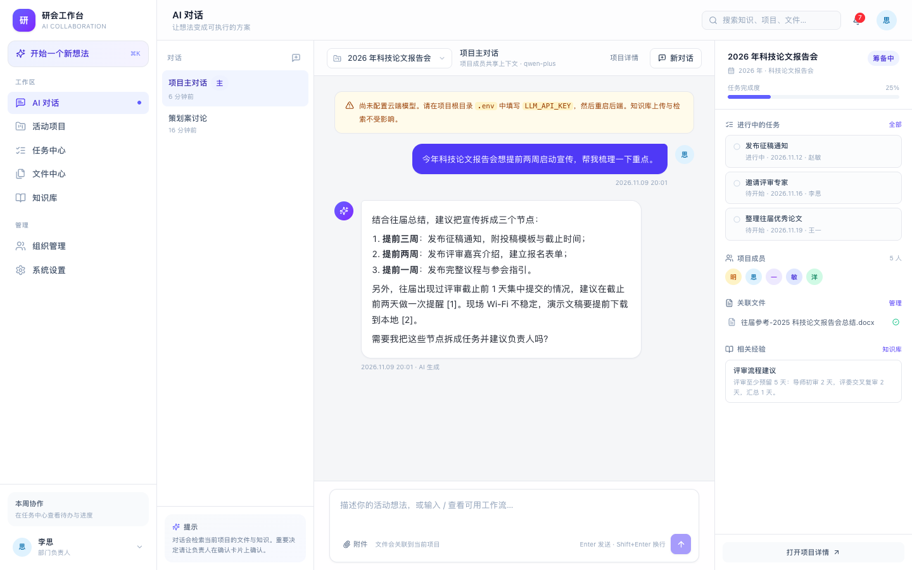
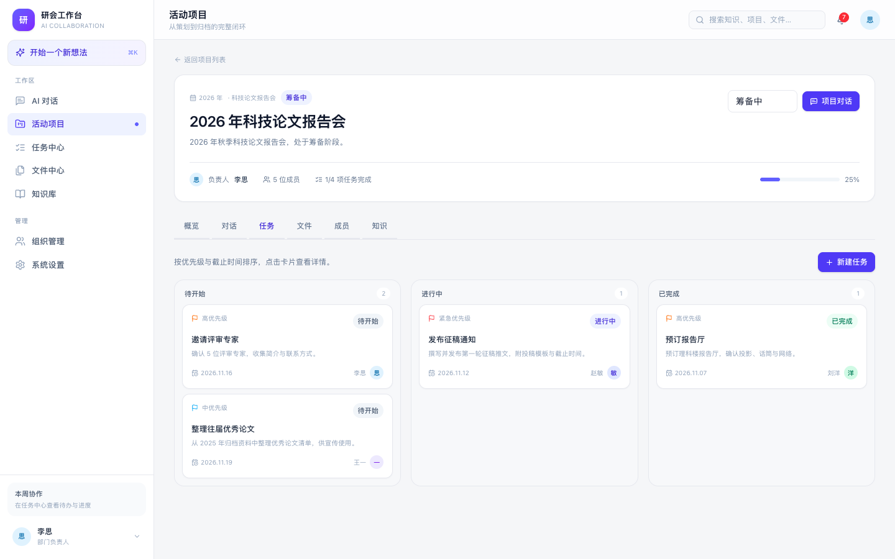
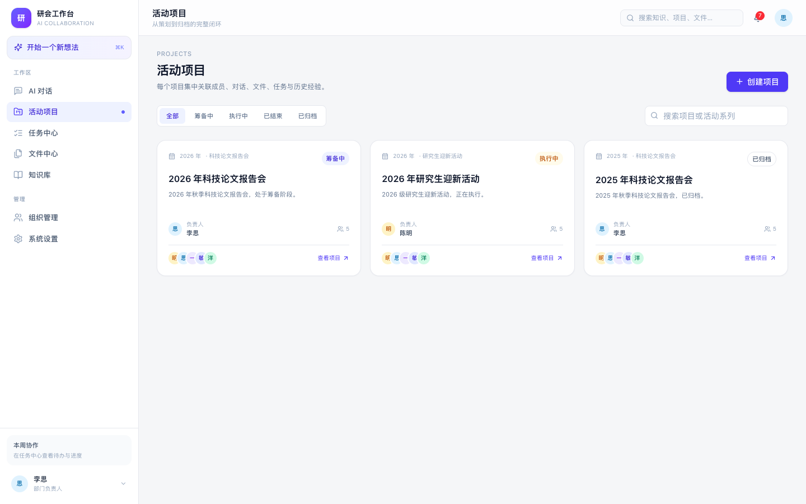
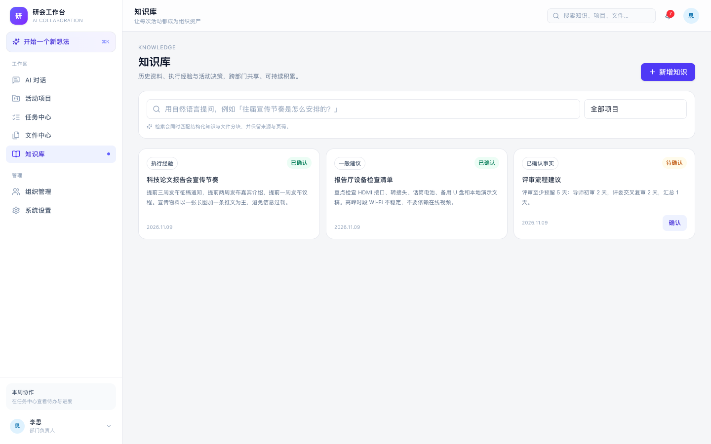

# Phase 1 完成情况

> 对照《项目说明.txt》§10 第一阶段「核心工作台 Demo」的 12 项要求。
> 日期：2026-11-09 · 环境：Mac mini M4 16GB / macOS 27 / Python 3.13.15 / Node 26 / Next.js 16.4.5

## 一、逐项验收

| # | 说明书要求 | 状态 | 实现说明 |
|---|---|---|---|
| 1 | 用户登录 | ✅ | JWT + HttpOnly Cookie；登录/登出/me；密码 Argon2 |
| 2 | 主席团、负责人、普通成员三种身份 | ✅ | `roles` + `user_roles`；后端 `require_roles`；前端按角色隐藏入口 |
| 3 | 桌面端三栏工作台 | ✅（对话页为四栏） | 左侧系统导航 + 对话列表，中间工作区，右侧项目上下文；小屏自动收起 |
| 4 | 全局 AI 对话 | ✅（需 Key） | 全局私人对话；真实调用 OpenAI 兼容接口；未配置 Key 返回 503 而非伪造 |
| 5 | 项目创建申请和负责人确认 | ✅ | 两条路径：① 对话中识别创建意图 → `AgentAction` 建议 → 负责人确认；② 普通成员在项目页提交「申请创建项目」→ 负责人/主席团在待确认列表确认。也支持负责人直接创建 |
| 6 | 活动项目列表与详情 | ✅ | 系列/年份/状态/负责人/成员/任务进度；卡片与详情页 |
| 7 | 项目主对话和多个主题对话 | ✅ | 每个项目自动生成主对话；支持新增主题对话；共享项目上下文 |
| 8 | 项目成员管理 | ✅ | 添加、申请、通过/拒绝；无项目内复杂角色 |
| 9 | 文件上传和下载 | ✅ | Word/PDF/文本/图片；原件持久化；异步解析；下载；分块预览 |
| 10 | 基础知识库检索 | ✅ | 中文分词 + tsvector 关键词检索；结构化知识条目；pgvector 向量检索接口已就绪 |
| 11 | AI 调用云端大模型 | ✅（待 Key 实测） | `LLM_API_KEY` 配置后调用；无 Key 时功能降级并明确提示 |
| 12 | 基础任务创建、分配和状态更新 | ✅ | 创建/优先级/截止/负责人/三状态/历史；额外实现任务交换 |

## 二、额外完成

- 项目申请加入 + 负责人审核（普通成员可发现筹备中/执行中的项目）。
- 任务交换：发起、接受/拒绝、双方负责人交换、历史记录、通知。
- 通知中心：未读数、列表、已读/全部已读。
- 知识条目：事实/经验/建议/推测四类，待确认/已确认/已归档。
- 文件分块预览与引用页码/标题路径。
- AgentRun / ToolCall / AgentAction 数据模型与执行记录。
- 示例数据：3 个项目、5 个账号、5 项任务、3 条知识、1 份往届总结 Word。
- 生产构建：Dockerfile、Compose、Caddy、本机服务脚本、Makefile。

## 三、未完成 / 留到 Phase 2

| 项 | 原因/计划 |
|---|---|
| Router + 4 Worker 的正式拆分 | Phase 1 用单 Agent + 确定性意图判断；Phase 2 引入 LangGraph，图跑在 RQ Worker |
| SSE 流式输出与事件回放 | 当前为请求-响应式；Phase 2 增加 `agent_events` + SSE |
| Word 策划案生成 | 当前只解析；Phase 2 python-docx + 模板 + 版本 |
| 文档局部修改/版本/审核 | 数据表已建（`document_versions`），接口与 UI 未做 |
| 知识自动提取 | 当前手动新增/确认；Phase 2 从对话和总结中提取 |
| 提示词版本管理 | 表已建（`prompts` / `prompt_versions`），管理 UI 未做 |
| OCR | 图片只存储，不解析；根据扫描件比例决定是否接 RapidOCR |
| 实时协同编辑 | 明确不做；采用「意见汇总 → 新版本」 |
| 移动端 | React Native 留到 Phase 3 |
| 任务交换独立页面 | API + 任务详情内发起 + 任务页接受已可用 |

## 四、验证记录

```text
$ cd backend && uv run pytest
11 passed, 26 warnings in 2.12s

$ cd frontend && pnpm typecheck
（通过）

$ cd frontend && pnpm build
✓ Compiled successfully
✓ Generating static pages (11/11)
```

浏览器验证（headless Chrome，1440×900）：

- `/login` 登录页渲染正常；
- 负责人登录后 `/chat`、`/projects`、`/projects/{id}?tab=tasks`、`/knowledge` 均正常；
- 项目对话可加载历史消息、主对话标识、右侧任务/成员/经验面板；
- 项目详情可切换概览/对话/任务/文件/成员/知识；
- 成员提交「申请创建项目」→ 负责人待确认列表 → 确认创建；
- Docker Compose 在 Colima（4C/6G）下构建并启动成功，Caddy `/health`、登录页、seed、登录均通过。

截图：

| 项目对话 | 项目任务 |
|---|---|
|  |  |

| 活动项目 | 知识库 |
|---|---|
|  |  |

## 五、已知问题与风险

1. **没有真实 API Key**：AI 对话链路用 mock 测试验证（`test_agent_proposal_and_confirm`），尚未用真实 DashScope Key 跑通；配 Key 后需做一次端到端验证。
2. **向量检索未实测**：没有 Key 时文件分块 `embedding` 为 NULL，关键词检索正常；配 Key 后需重新上传/重处理文件生成向量。
3. **对话页四栏**：在 1440px 下可用；若觉得拥挤，可把对话列表收进左侧导航的折叠区。
4. **任务交换 UI 较基础**：没有独立的交换记录页；接受入口在任务中心顶部。
5. **Word 复杂排版**：Phase 2 只承诺段落级修改；页眉页脚/文本框/编号的完整保真需要 LibreOffice 方案，成本更高。
6. **单机资源**：本机栈常驻约 2–3.5GB；Docker Compose 全部服务约 6–7GB limit，演示前建议关闭不用的应用。

## 六、下一步建议（Phase 2 入口）

1. 配置 `LLM_API_KEY`，跑通真实对话、Embedding 与「对话创建项目 → 确认」全链路。
2. 引入 LangGraph（仅 core + checkpoint-postgres），把「策划案生成 / 任务拆分 / 多轮修改」三条长流程迁到 RQ Worker。
3. 实现 Word 模板生成 + `document_versions` + 审核状态。
4. 增加 SSE 事件流与执行时间线（复用 `agent_runs` / `agent_events`）。
5. 补充检索评测集（20–30 个真实问题），调 chunk 大小、top_k 与 RRF 权重。
