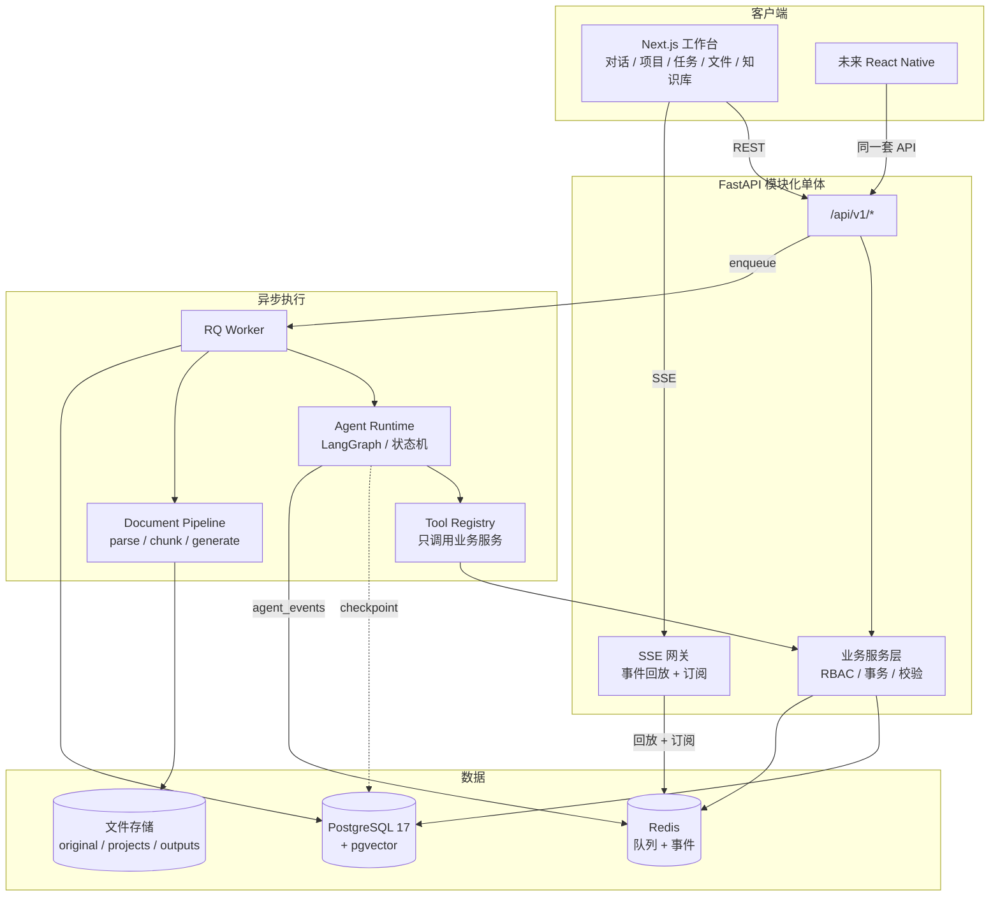
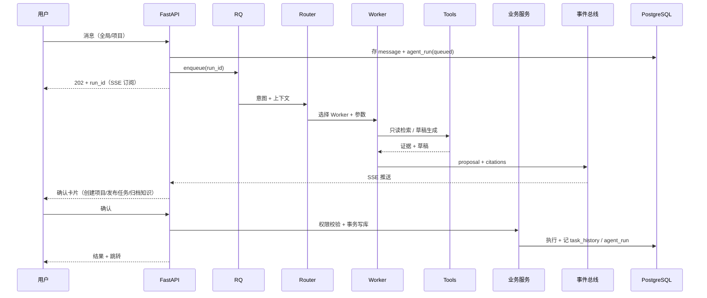

# 研究生会 AI 协同工作台
## 开源项目源码级调研与技术选型报告

| 项目 | 内容 |
|---|---|
| 版本 | v1.0 |
| 日期 | 2026-11-09 |
| 调研对象 | Dify 1.19.0、RAGFlow 1.0.0、LangGraph 1.2.20、Plane（HEAD 2026-11-03）、AnythingLLM 1.19、Open WebUI 0.13.3 |
| 调研方式 | GitHub 浅克隆 + LICENSE 实读 + `docker-compose`/依赖树/源码路径核对 + Docker Hub 镜像体积核对 |
| 运行环境 | Mac mini M4 / 16GB 统一内存 / macOS 27 / Python 3.14.7 / Node 26.10.0 / pnpm 12.6.0 |
| 当前缺失 | 本机尚未安装 Docker、PostgreSQL、Redis（见 §9.4 当前环境缺口） |

> 本文回答六个问题：① 重点项目的核心架构与技术栈；② 哪些能直接复用、哪些只能参考；③ 哪些功能值得移植；④ 是否与 FastAPI + Next.js 冲突；⑤ Mac mini M4 16GB 资源评估；⑥ 最终技术选型。
>
> 结论先行：**不部署任何一个候选系统作为运行时组件；唯一直接引入的代码依赖是 LangGraph（Phase 2 起，库级使用）。其余价值全部以「设计参考 + 交互参考」的方式吸收，业务主数据只存一套 PostgreSQL。**

---

## 0. 结论摘要

### 0.1 推荐组合

| 层 | 选型 | 引入方式 | 说明 |
|---|---|---|---|
| Web 工作台 | Next.js + TypeScript + Tailwind + shadcn/ui | 自研 | 三栏布局、SSE 流式、引用卡片 |
| 业务后端 | FastAPI + SQLAlchemy 2 + Alembic | 自研 | 模块化单体，`/api/v1` |
| Agent 编排 | **LangGraph（仅 Phase 2 起）** | **L1 直接依赖** | core + checkpoint-postgres，不用 Server/Platform |
| 文档解析 | PyMuPDF + python-docx（+ 可选 RapidOCR） | 自研管线 | 版式/表格/页码可定位 |
| 文档生成 | python-docx + docxtpl | 自研管线 | 模板生成，版本不可变 |
| 检索 | PostgreSQL + pgvector + 关键词混合检索 | 自研 | 数据量级完全够用（§8.3） |
| 项目/任务 | 自研（参考 Plane 的信息架构） | 自研 | 任务交换、历史、通知 |
| 数据层 | PostgreSQL 17 + pgvector、Redis、本地文件存储 | 自建 | 单一数据平面 |
| 部署 | Docker Compose 6 个服务（含 Caddy） | 自建 | 常驻约 2–3.5GB |

### 0.2 五条关键判断

1. **没有「拿来即用」的主系统。** 六个候选都是完整平台，各自带用户、租户/工作区、知识库、会话主键；直接部署会立即产生第二套主数据，破坏「项目 ↔ 对话 ↔ 文件 ↔ 任务 ↔ 知识」的统一关系。
2. **可直接复用的代码几乎为零。** 真正符合「许可证干净 + 语言栈一致 + 耦合低」的只有 LangGraph（MIT，纯 Python 库）。Dify 的引擎已抽成 `graphon`（Apache-2.0），但版本仅 0.9、要求 Python < 3.14，暂列观察项。若部署 Dify，其 Service API + `dify-client`（MIT）是干净的 L1 集成面；但本项目不部署，故不计入。
3. **Dify + LangGraph 不是自然组合。** Dify 1.19 新增的 `agent_backend` 基于 `pydantic-ai`，核心 API 另有自研 Agent runner，与 LangGraph 是两套编排范式；同时部署等于两套状态机、两套会话、两套知识库。二者只能选一个作为「编排层」，本项目选自研业务 + LangGraph。
4. **RAGFlow 已重写为 Go，且与 pgvector 硬冲突。** Python 解析栈已删除，DeepDoc 改为 Go + ONNX 进程内推理；镜像从 0.27 的 3.6GB 降到 360MB，但运行时要 MySQL + ES + MinIO + KVrocks + NATS 共 6 个容器，稳态 7–9GB，且元数据库不支持原生 PostgreSQL、向量只能进它的 doc engine。open-core 还把「独立解析服务」切给企业版。
5. **Plane 只能参考，不能复制。** 许可证是 AGPL-3.0-only，复制其前端组件会传染我们的代码；且它是 Django + React Router 8 + MobX 的独立产品（纯 CSR），与 Next.js 无共用基础。

### 0.3 复杂度红线

任何方案，只要触发以下任一条，即否决：

- 需要维护**第二套用户/登录体系**；
- 需要维护**第二套知识库或向量库**；
- 需要把我们的 `project_id` / `conversation_id` 同步到外部系统；
- 需要为「参考一个 UI」而常驻 3 个以上额外容器。

### 0.4 五个反直觉发现（与初始假设不同）

1. **Dify 不是 FastAPI，且已经是「平台级」体量。** 后端是 Flask 3.1 + Celery，默认 16 个容器；最新的 `knowledge_fs` 文档解析是**私有引擎、仅 amd64、默认关闭**，M4 上直接不可用。
2. **RAGFlow 1.0 已经没有 Python 解析栈了。** `api/rag/deepdoc/agent` 全部删除，DeepDoc 用 Go + ONNX 进程内推理；元数据库不支持原生 PostgreSQL，向量只能进它的 doc engine，**与 pgvector 硬冲突**；「只做解析」的 `--deepdoc` 模式是企业版专属。
3. **LangGraph 官方在收缩 agent 层。** 它正被定位为 runtime，`prebuilt/supervisor/swarm` 进入 maintenance-only，`create_react_agent` 已 deprecated；而且 **SSE 断连会取消执行、没有事件回放**，所以图必须跑在 RQ worker，而不是 FastAPI 请求里。
4. **Plane 已经不是 Next.js 了。** 前端迁到 React Router 8（纯 CSR）+ MobX，`next/*` 只是兼容垫片；AGPL-3.0 下复制组件会传染整个系统。
5. **Open WebUI 的「50 用户」不是使用上限。** 它只是「可以去掉品牌」的豁免线；超 50 人仍可自托管，但必须保留品牌。另外它默认启动就加载本地 sentence-transformers，标准镜像 4–6GB。

---

## 1. 调研方法与复用分级

### 1.1 实际做了什么

- 浅克隆 6 个仓库 + Dify 抽出的 `graphon`，核对 HEAD 提交（见附录 A）；
- 逐字阅读 LICENSE，确认附加条款（Dify 多租户/LOGO、Open WebUI 品牌条款、Plane AGPL）；
- 解析 `docker-compose` 的服务清单、profile、默认依赖；
- 核对后端框架版本、ORM、迁移工具、前端框架；
- 读取核心模块源码（工作流引擎、检索、任务模型、消息流）；
- 通过 Docker Hub API 核对镜像压缩体积，作为资源评估的硬证据；
- 未做真实压测：内存数字为「镜像 + 依赖 + 默认配置」的量级估算，已标注；
- 行号以各仓库 HEAD 为准，上游升级后会漂移；结论基于 2026-11-09 的代码状态。

### 1.2 复用分级

| 级别 | 含义 | 许可要求 |
|---|---|---|
| **L1 直接依赖** | 以 pip/npm 包引入，不改源码 | 宽松许可（MIT/Apache/BSD） |
| **L2 复制代码** | 摘取少量源码/组件进本仓库 | 许可兼容且耦合低；AGPL 一律禁止 |
| **L3 参考设计** | 重写，但沿用其数据结构/交互/流程 | 无许可义务（不复制表达） |
| **L4 不可用** | 不引入、不复制、不部署 | — |

### 1.3 核心判据：主数据归属

选型的第一性问题不是「谁功能强」，而是「谁是主数据的 owner」。本系统的五个核心实体是：

```
Project ──< Conversation ──< Message
   │            │
   ├──< File ───┘
   ├──< Task
   ├──< Knowledge ──< KnowledgeSource
   └──< AgentRun ──< ToolCall
```

它们必须共享同一套 UUID 主键、同一套 RBAC、同一套软删除与审计。任何外部平台只要自带 `tenant/workspace/knowledge_base/conversation` 主键，接入时就必然要做双向同步；同步一旦引入，权限校验、级联删除、引用完整性、审计都会从「数据库约束」退化为「分布式一致性问题」。这是本项目最应该避免的复杂度。

---

## 2. 需求侧的五个硬约束

| # | 约束 | 对选型的含义 |
|---|---|---|
| 1 | 业务闭环跨模块：想法 → 检索 → 策划案 → 任务 → 执行 → 总结 → 经验 | 必须有统一 `project_id` 贯穿；平台级 sidecar 会切断这条链 |
| 2 | 三栏工作台，右侧要显示当前项目/文件/任务/经验 | 前端必须能同时读多个业务域；外部聊天 UI 无法满足 |
| 3 | 文档要「解析 → 生成 → 局部修改 → 版本 → 审核」 | 需要自己的文件版本模型，不能托管在别人的知识库里 |
| 4 | Mac mini M4 16GB，单机 Docker Compose | 每增加一个数据平面，内存与运维成本翻倍 |
| 5 | Demo 周期短，团队小，AI 辅助开发 | 优先「少依赖、可调试、结构稳定」，其次才是功能多 |

补充事实：项目说明书要求「不要过早引入微服务、复杂消息中间件和多 Agent 框架」。这条应作为选型的否决项，而不是口号。

---

## 3. 三个重点项目的架构与技术栈

选择 Dify、LangGraph、Plane 作为重点，是因为它们分别代表「平台」「编排内核」「项目协作产品」三种形态；RAGFlow 因与 pgvector 硬冲突、且已完成 Go 重写，放在 §4，但仍做了同等深度的源码核对。

### 3.1 Dify 1.19.0 —— 完整的 LLM 应用平台，不是组件

**定位**：可视化工作流 + RAG + Agent + 模型管理 + 插件市场的一体化平台。

**技术栈（源码核对）**

| 层 | 实现 | 证据 |
|---|---|---|
| 后端 | **Flask 3.1 + flask-restx + SQLAlchemy 2.0.49 + Alembic 1.17.2（247 个迁移）+ Celery 5.6 + gevent**（不是 FastAPI） | `api/pyproject.toml`、`api/migrations/` |
| 前端 | Next.js 16.4.5 + React 19.3.1 + TS 6.0.2，`output: standalone` | `web/package.json`、`web/next.config.ts` |
| 工作流引擎 | 已抽为独立包 **`graphon`**（git pin，804 处 import） | `api/uv.lock`、`api/core/workflow/node_factory.py` |
| Agent 运行时 | 新增 `agent_backend`（FastAPI + pydantic-ai）+ Go `dify-agent-runtime` | `dify-agent/pyproject.toml`、`docker/docker-compose.yaml` |
| 文档解析 | `knowledge_fs` 系列：**私有引擎、仅 amd64、默认关闭** | `api/Dockerfile:1-3`、`docker-compose.yaml:668` |
| 数据层 | PostgreSQL/MySQL + Redis + 可选 Weaviate/Qdrant/Milvus/ES 等 | `docker/docker-compose.yaml` |
| 部署 | 47 个服务定义；默认 profile 起 **16 个容器**；**必需仅 6 个**（api/worker/beat/redis/db/plugin_daemon） | `docker/.env.example`、compose 解析 |

**核心机制（值得看的部分）**

- **节点化工作流 + 变量池**：节点声明输入/输出变量，引擎负责拓扑排序、分支、并行、暂停；`human_input` 原生支持人工确认。这是「固定工作流」最值得借鉴的抽象。
- **版本化模型**：`draft/published` 双态 + 单调递增 `version_number` + 标注（`api/models/workflow.py:221-231,743-758`）。这正是我们「策划案版本 + 提示词版本」可以直接照搬的结构。
- **检索配置 `RetrievalModel` + 后处理链**：`search_method / reranking / top_k / score_threshold / weights` 配置化，后处理按 rerank → 阈值 → 去重执行（`api/services/knowledge/entities/knowledge_entities.py:139-177`、`api/core/rag/data_post_processor/`）。
- **运行追踪**：`agent_runs / workflow_node_executions / tool_calls` 三层记录，前端可逐节点回放。
- **没有 Word 生成能力**：`word_extractor.py` 只读 docx，全仓无 docx 写入代码。策划案生成必须自研。

**复用判定**

| 模块 | 级别 | 理由 |
|---|---|---|
| Service API（workflow run / dataset retrieve）+ `dify-client`（MIT） | L1（仅当部署 Dify） | 稳定 REST + Bearer token；但本项目不部署，不计入 |
| 版本化模型 / 检索配置 / 变量选择器 / HITL 状态机 | L3 | 结构清晰，重写成本 2–6 人日/项 |
| 工作流引擎 `graphon` | 观察 | Apache-2.0 干净，但 0.9.0、Python 3.12–3.13、API 未稳定 |
| 会话/消息、多租户权限、插件系统、Agent v2、画布前端 | L4 | 与我们的项目模型/角色模型冲突；画布有外观专利 |
| 整套 Dify | L4 | 第二套用户/租户/知识库；Flask 栈；部署面过大 |

**许可证（必须注意）**

- 修改版 Apache-2.0：未经书面授权**不得多租户**（一个 workspace 即一个 tenant）；使用其前端**不得移除 LOGO**；另有画布外观专利。
- 社区版细粒度 RBAC 实为 no-op，只有 workspace 级 5 种角色；无法表达「项目成员只读」这类规则。
- 内部单组织、单 workspace 自用不触发多租户条款；但这也说明它不是可随意嵌入的基础库。

**资源量级**：全量默认 profile 常驻 **4–5GB**（不含 Docker VM），镜像 3.5–5GB，冷启动 60–120s（247 个迁移）；裁剪到 api+worker(-c1)+beat+plugin_daemon+redis+pg+pgvector 约 **2.6–3.6GB / 5 容器**。但裁剪版仍带第二套会话/知识库模型。

**结论：不部署。** 它是「产品设计参考库」，不是「组件」。其 `Service API` 确实是干净的集成面，但接入的前提是接受「Dify 侧会话/索引为派生数据」，这与我们「统一数据模型」的目标相悖；且它不能生成 Word。

---

### 3.2 LangGraph 1.2.20 —— 唯一值得直接依赖的项目

**定位**：有状态图执行引擎（Pregel/BSP 模型）。官方正在把它收敛为「runtime」，而不是 agent 框架。

**技术栈（源码核对）**

| 项 | 内容 |
|---|---|
| 语言 | Python ≥3.10（异步注入需 3.11+，建议 3.12） |
| 许可证 | **MIT** |
| 核心依赖 | `langchain-core>=1.4.7,<2`（绑定 config/callback/message 协议，不是 agent 抽象）、`langgraph-checkpoint`、`langgraph-sdk`、`langgraph-prebuilt`、`pydantic` |
| 持久化 | `checkpoint-postgres` / `checkpoint-sqlite`；PG 侧 4 张表，由 `setup()` 自建，**非 Alembic** |
| 服务 | 纯库，不需要独立服务；LangGraph Server 不在本 MIT 仓库内 |
| 官方趋势 | `AGENTS.md:29-34` 明示收敛为 runtime；prebuilt/supervisor/swarm 为 **maintenance-only**；`create_react_agent` 已 deprecated |

**核心机制**

- **`StateGraph` + reducer**：状态是 TypedDict/Pydantic，节点返回增量；支持条件边、并行 fan-out（`Send`）、子图；`Pregel` 按 Plan/Execution/Update 三阶段推进。
- **每个 superstep 落盘**：pending writes 保证「已完成的节点不重跑」，这是自研最难的部分。
- **`interrupt()`**：暂停并落库，客户端用 `Command(resume=...)` 续跑；**恢复时节点从头重跑**。
- **流式**：7 种 `stream_mode`；v2 的 `StreamPart` 可直接映射为 SSE 事件。
- **没有持久化任务队列**：`_queue.py` 只是进程内队列；checkpoint 存了状态，但**没有人替你重新驱动**，必须自己用 RQ/补偿任务。

**复用判定**

| 模块 | 级别 | 说明 |
|---|---|---|
| Graph 执行 + checkpoint + interrupt | **L1** | 省掉约 800–1500 行最难的状态机 |
| `checkpoint-postgres` | **L1** | 与业务共库，独立 schema 隔离 |
| prebuilt agent 工厂 / `ToolNode` 写操作 | **L4** | maintenance-only / deprecated；`ToolNode` 会把异常回喂模型，不适合写操作 |
| LangGraph Server / Platform | L4 | 不在 MIT 仓库、额外进程与第二套鉴权 |
| LangChain agents | L4 | 只用 `langchain-core` 的协议类型即可 |

**集成方式（关键：不要放在请求协程里）**

```
FastAPI:  POST /agent/runs              → agent_runs(queued) + RQ enqueue
          POST /agent/runs/{id}/resume  → 鉴权 → RQ enqueue(approval_id, decision)
          GET  /agent/runs/{id}/events  → SSE：先回放 agent_events(seq>after)，再订阅 Redis

RQ worker: graph（进程级单例）+ 同步 PostgresSaver
           graph.stream(..., stream_mode=["values","updates","messages","custom"],
                        version="v2", durability="sync")
           → 写 agent_events + Redis pub/sub
           → 遇 interrupt：status=waiting_approval，job 正常结束
```

原因：LangGraph 的执行由消费者驱动，**SSE 断连会取消执行，而且没有事件回放**。把图放在 FastAPI 请求协程里，用户一刷新页面任务就死。

**五个坑**

1. **中断节点从头重跑**：提议与执行必须拆成两个节点；写库放在 resume 之后，先 `approvals.consume()` 做服务端权限校验，再带幂等键执行。
2. **SSE 断连即取消、无回放**：执行放 RQ 后台；事件双写（表用于回放、Redis 用于分发）。
3. **checkpointer 并发模型**：saver 绑 event loop + 整段 DB 操作一把锁、同 thread 无锁 → 进程级单例；resume 前加 `pg_advisory_xact_lock(hashtext(thread_id))` 或 Redis 锁。
4. **`recursion_limit` 默认 10007**：必须显式设 20–50。
5. **checkpoint 表非 Alembic**：放独立 schema（`search_path=agent,public`），`setup()` 一次性执行；`delete_for_runs` 在 PG 未实现，清理逻辑自己写。

**安全**：生产置 `LANGGRAPH_STRICT_MSGPACK=true`；state 只放 id/摘要，不放全文。

**资源**：基线 80–120MB，每张图 <5MB；16GB 很宽裕。跑 Server 反而 +250–500MB 与第二套鉴权，不划算。

**结论：Phase 2 采用，只用 core + checkpoint-postgres + interrupt。** 用 `AgentRuntime` Protocol 包一层（start/resume/snapshot），隔离 API 变化。

---

### 3.3 Plane 1.5.0 —— 成熟的项目管理产品，但 AGPL

**定位**：Jira 类项目管理/任务协作产品（Workspace → Project → Issue）。

**技术栈（源码核对）**

| 层 | 实现 | 证据 |
|---|---|---|
| 后端 | **Django 5.2.17 + DRF 3.18.3 + Celery 5.5.3 + RabbitMQ**，Python 3.12 | `apps/api/pyproject.toml` |
| 前端 | **React Router 8（framework mode）+ MobX + Vite**，纯 CSR（不是 Next.js） | `apps/web/package.json`、`apps/web/react-router.config.ts:10-11` |
| 数据库 | PostgreSQL 15 | `docker-compose.yml` |
| 队列/存储 | RabbitMQ + Valkey + MinIO（`pgsty/silo`） | `docker-compose.yml` |
| 服务数 | 12 个常驻 + 1 个一次性 migrator，共 13 个 | `docker-compose.yml` |
| 官方最低配置 | 2 vCPU / 4GB | `deployments/cli/community/README.md:13` |
| 许可证 | **AGPL-3.0-only** | `LICENSE.txt`、源文件 SPDX 头 |

**任务模型（值得借鉴的信息架构）**

`apps/api/plane/db/models/issue.py`：

- `Issue` 继承 `ProjectBaseModel`，字段含 `parent`（子任务）、`state`、`priority`（urgent/high/medium/low/none）、`assignees`、`labels`、`start_date/target_date`、`estimate`；
- `TRACKED_FIELDS = ["state_id"]` + `ChangeTrackerMixin`：状态变更自动记活动流；
- `State` 带 `group`（backlog/unstarted/started/completed/cancelled）与 `completed_at`，状态机语义清晰；
- 活动流是**字段级 diff + 渲染注册表**，不是一段纯文本；
- 列表支持**服务端分组 + 分页**，视图/筛选配置持久化在项目上。

这告诉我们：任务卡正面只放 5 个字段（标题/优先级/截止/负责人/状态），其余进详情；状态变更必须进活动流；视图偏好存 JSON，不要为每种视图建表。

**复用判定**

| 模块 | 级别 | 理由 |
|---|---|---|
| 任务卡字段与信息层级 | L3 | 直接照搬产品决策 |
| State group 状态机 + 字段级活动流 | L3 | 与说明书 §6.6 高度一致 |
| 服务端分组分页 + 视图配置 | L3 | 任务多时避免前端全量加载 |
| 命令面板 / 快捷键注册表 | L3 | 提升桌面端效率 |
| 前端组件/`@plane/*` 包 | **L4** | AGPL 传染 + MobX/propel 三重耦合 |
| 整个 Plane | L4 | 13 容器、独立工作区模型、与我们的 RBAC 冲突 |

**许可证约束（关键）**

AGPL-3.0 §13：修改后通过网络提供服务，必须向用户提供对应源码。复制其 `.tsx` 进我们的组件目录，与闭源代码一起编译、一起提供服务，即构成组合作品。**不要复制代码，只参考交互与数据模型。**

**资源量级**：13 个服务空载 **3.4–5.2GB**（默认 Celery concurrency = CPU 核数，M4 10 核会起 10 个子进程，必须压到 2）；首次构建峰值 10–12GB，磁盘预留 20–30GB。官方最低 4GB 只是「能启动」，不含开发环境。

**结论：仅参考。** 借任务卡 IA、状态组、活动流、服务端分组、命令面板；不借甘特图/周期/模块/多工作区。

---

### 3.4 三个重点项目对比

| 维度 | Dify | LangGraph | Plane |
|---|---|---|---|
| 形态 | 平台（含 UI/租户/插件） | 编排 runtime | 项目管理产品 |
| 语言/框架 | Flask + Next.js | Python 纯库 | Django + React Router 8 |
| 许可证 | 修改版 Apache-2.0（多租户/LOGO） | **MIT** | **AGPL-3.0** |
| 部署单元 | 16 容器（必需 6） | 0（进程内） | 13 容器 |
| 常驻内存 | 4–5GB | 0.08–0.12GB | 3.4–5.2GB |
| 主数据 | 自带 tenant/workspace | 无 | 自带 workspace |
| 与我们的关系 | 设计参考 | **直接依赖** | 交互参考 |
| 结论 | 不部署 | Phase 2 采用 | 不复制 |

---

## 4. 另外三个候选：确认「不采用」

### 4.1 RAGFlow 1.0.0 —— Go 重写、open-core、与 pgvector 硬冲突

**源码事实（与常见认知不同）**

- **Python 解析栈已被删除**：`api/`、`rag/`、`deepdoc/`、`agent/` 在本 HEAD 不存在；Python 只剩 SDK/tools/测试。
- 单二进制六种模式（api/admin/ingestor/syncer/deepdoc/migrate）；DeepDoc 用 **Go + 静态链接 ONNX Runtime** 进程内推理（det/layout/tsr/rec.ort + ocr.res，CPU）。
- **`--deepdoc` 独立推理服务是企业版专属 stub**（`cmd/stub.go:30`），OSS 版不提供「只做解析」的模式。
- 前端 React 18 + Vite 7（不是 Next.js）；元数据库 MySQL 8（不支持原生 PostgreSQL）；向量/全文 ES 8 / Infinity；对象存储 MinIO；缓存 KVrocks；MQ NATS。
- 必需 **6 个常驻容器**：ragflow + MySQL + ES + MinIO + KVrocks + NATS。
- 许可证 Apache-2.0 纯标准文本，但 open-core：EE 功能用 build tag 切走。

**为什么不用**

1. **与 pgvector 硬冲突**：向量只能进它的 doc engine，没有 PG 通道；元数据库也不支持原生 PG。接入 = 维护 5 个有状态服务的第二数据平面。
2. **不能只抽 parser**：Python 实现已删，Go 代码全在 `internal/`（外部模块不可 import）；独立 DeepDoc 是 EE 专属。要用只能跑整套。
3. **macOS 不友好**：官方明确 macOS 暂不支持 Go 后端，compose 强制 `linux/amd64`（Rosetta）。
4. **资源**：稳态 7–9GB、峰值 10–13GB，官方建议 4 核/16GB/50GB 磁盘。

**借鉴什么**：`positions` 五元组（page/left/right/top/bottom）+ `img_id` 的引用定位；句级引用插入（cosine + 阈值 + 跳过代码块）；表格 HTML 化（rowspan/colspan）+「每行一 chunk」；分块族（general/token/title/page/table/qa/one）。

**备选路径（仅 P3 评估）**：把 RAGFlow 当「低频重解析设备」——批量解析 → 通过 API 拉取 `content + positions` → 灌入我们的 pgvector → 停容器。适合扫描件/复杂表格集中入库，不适合日常链路。即使采用，它也只是 parser，不是知识库。

**结论：不部署。**

### 4.2 AnythingLLM 1.19 —— 文档聊天工作台

- **MIT**（纯 MIT，`TERMS_SELF_HOSTED.md` 只是隐私说明，不是附加许可）；Node.js + Express 4 + Prisma 5 + React/Vite；默认 LanceDB，另适配 11 种向量库；默认本地 ONNX embedding（`Xenova/all-MiniLM-L6-v2`）。
- **硬伤**：SQLite 硬编码（41 个 SQLite 迁移，PG 仅注释）、默认单用户无鉴权、开发者 API 是实例级 key、对话 `user_id=null`。这些使它无法作为多用户工作台的后端。
- 优点：Workspace ↔ Document 绑定清晰，embedding 子进程隔离（OOM 只杀 worker）、SSE 进度与断线重放、引用只显示本次命中。
- 不采用；与 Python 后端也不同栈。
- **借鉴**：文档处理四态 + 子进程/队列隔离 + 断线重放、SSE 事件语义、引用合并。

### 4.3 Open WebUI 0.13.3 —— 可选旁路，但主链路不用

- 后端 **FastAPI 0.136.3 + SQLAlchemy 2 + Alembic**（与我们同栈），前端 **SvelteKit**；默认 SQLite，PG 一等公民；默认 chroma 内嵌，slim 镜像默认 pgvector。
- 许可证是「BSD-3 + 品牌条款」：50 用户/30 天只是「可去品牌」的豁免线，**不是使用上限**；超 50 人可自托管，但必须保留品牌。
- **默认启动即加载本地 sentence-transformers**（`main.py:694`），可切外部 embedding；标准镜像 4–6GB，slim 镜像 1–1.5GB 但只能本地解析 csv/html/txt/md/xml，PDF/DOCX 必须外接解析器。
- 技术上可做旁路：`trusted header` 接我们的 SSO、pgvector 同实例、用户级 API key。但仍是第二套用户/知识库，且 0.13.x 每周迭代。
- **结论：Demo 不部署。** 若未来需要一个「内部灰度/兜底聊天入口」，可作为旁路 sidecar，独立 compose、锁 digest、独立 database、外部 embedding，不进主链路。
- **借鉴**：语义化 SSE（`textResponseChunk / sources / abort / finalize`，引用只在末块）、引用角标+侧栏、文件四态状态机、项目默认模型+会话覆盖、按消息分叉。

### 4.4 n8n / OpenProject / Flowise：快速排除

| 项目 | 许可证/状态 | 技术栈 | 为什么不纳入 | 可借鉴 |
|---|---|---|---|---|
| n8n | Sustainable Use License（非 OSI 宽松许可） | Node/TypeScript | 定位是自动化集成，不是业务系统；许可证对再分发/商用有限制 | 通知、定时任务、Webhook 的编排思路（我们用 RQ + APScheduler 足够） |
| OpenProject | GPLv3 | Ruby on Rails | 语言栈不兼容、部署重、偏传统项目管理 | 项目模板、里程碑、工时统计的产品思路 |
| Flowise | 官方已公告停止维护（据项目公告） | Node/React | 不再作为新项目基础 | 不评估 |

> 这三个项目均不进入候选短名单；列出是为了说明「不是没看过」，而是主动排除。

---

## 5. 横向对比总表

| 项目 | 语言/框架 | 许可证 | 部署单元 | 常驻内存（估） | 能否直接复用 | 定位 |
|---|---|---|---|---|---|---|
| Dify | Flask + Next.js | 修改版 Apache-2.0 | 16 容器（必需 6） | 4–5GB | 否（仅设计） | 平台 |
| RAGFlow | Go + ONNX | Apache-2.0（open-core） | 6 容器 | 7–9GB | 否（仅设计） | 文档/RAG 平台 |
| LangGraph | Python 库 | **MIT** | 0 | 0.08–0.12GB | **是（L1）** | 编排 runtime |
| Plane | Django + React Router 8 | **AGPL-3.0** | 13 容器 | 3.4–5.2GB | 否（仅交互） | 项目管理产品 |
| AnythingLLM | Express + React | MIT | 1 容器 | 0.5–0.7GB | 否（仅交互/少量模式） | 文档聊天产品 |
| Open WebUI | FastAPI + SvelteKit | BSD-3 + 品牌条款 | 1 容器 | 0.5–1.5GB | 否（旁路可选） | 通用聊天产品 |
| graphon（Dify 引擎） | Python 库 | Apache-2.0 | 0 | 0.1GB | 观察（0.9.0） | 工作流引擎 |

> 内存为「容器常驻」量级估算，不含 Docker Desktop 的 Linux VM（另加 1.5–3GB）与 macOS 自身（4–6GB）；依据：镜像体积、compose 服务数、默认依赖（ES/MySQL/MinIO/NATS/TEI/transformers）与官方最低配置。未做实测。

---

## 6. 与 FastAPI + Next.js 的冲突分析

> 说明：当前工作区只有需求说明书，尚无既有代码；这里的「现有架构」指说明书确定的目标栈（Next.js + FastAPI + PostgreSQL + Redis + Docker Compose）。

| 冲突点 | Dify | RAGFlow | LangGraph | Plane | AnythingLLM | Open WebUI |
|---|---|---|---|---|---|---|
| 后端框架 | Flask，异构 | Go，异构 | 库，无冲突 | Django，异构 | Express，异构 | FastAPI，同栈 |
| 用户/登录 | 自带租户体系 | 自带用户/租户 | 无 | 自带 workspace | 默认单用户无鉴权 | 自带用户（可接 SSO） |
| 会话归属 | 自带 conversation | 无 | 无 | 无 | 自带 thread | 自带 chat |
| 知识库归属 | 自带 dataset | 自带 KB | 无 | 无 | 自带 workspace | 自带 knowledge |
| 迁移工具 | Flask-Migrate | GORM AutoMigrate | 自建表 | Django migrations | Prisma（SQLite 硬编码） | Alembic |
| 前端复用 | Next.js 但重耦合 | React 18 + Vite | 无 | React Router 8/MobX | React/Vite | Svelte |
| 结论 | 高冲突 | 高冲突 | **无冲突** | 高冲突 | 高冲突 | 中高冲突（旁路可选） |

**关键结论**

1. **只有 LangGraph 不制造第二套主数据。** 它是进程内库，checkpoint 表可以放独立 schema，业务真值仍在我们的表里。
2. **「sidecar 集成」只在一种情况下成立：单一职责、无状态的服务**，例如「PDF 转文本」。Dify/RAGFlow/Plane 都是「有状态平台」，sidecar 化等于把主数据切走一半。
3. **同栈不等于可复用。** Open WebUI 后端也是 FastAPI，但它的路由、模型、鉴权、依赖树都是为「通用聊天」设计的；抽取成本高于重写。
4. **前端组件不可跨栈复制。** Dify 用 Base UI、Plane 用 MobX + `@plane/propel`、Open WebUI 用 Svelte、AnythingLLM 用 Vite React；复制任何一个都会把对方的构建体系带进来。

### 6.1 组合方案推演：拼起来会发生什么

| 组合 | 直接后果 | 额外成本 | 结论 |
|---|---|---|---|
| Dify + 我们 | 两套用户/会话/知识库；Dify 不能生成 Word | 同步任务、鉴权桥、定期清理 | ❌ |
| RAGFlow + 我们 | 两套数据平面（MySQL+ES+MinIO+KVrocks+NATS）；无 PG 通道 | 6 容器、7–9GB、amd64 模拟 | ❌ |
| Plane + 我们 | 两套任务/成员/工作区；AGPL 传染 | 13 容器、Django 重写 | ❌ |
| Open WebUI + 我们 | 两套用户/知识库；Svelte 前端无法并入 | 1 容器 + SSO 桥 | ⚠️ 仅旁路 |
| LangGraph + 我们 | 只多一个 `agent` schema 与 4 张 checkpoint 表 | ~200 行胶水 | ✅ |

---

## 7. 值得移植的功能清单

### 7.0 模块级复用判定总表

| 模块 | 候选来源 | 级别 | 我们的做法 |
|---|---|---|---|
| 认证 / 用户 / 部门 | 无（所有平台都自带） | 自研 | JWT + RBAC，三张表 |
| 对话 UI / SSE 流式 | Open WebUI | L3 | Next.js 重写 |
| 消息树 / 重新生成 | Open WebUI | L3 | 消息 `parent_id` + 重新生成 |
| 知识库管理 / 引用展示 | Dify、RAGFlow | L3 | 自研表 + 引用 chip |
| 文档解析 | RAGFlow | L3 | PyMuPDF / python-docx 自研管线 |
| 引用定位（页码 / bbox / 句级插入） | RAGFlow | L3 | chunk 元数据 + 前端跳转 |
| 向量检索 / 混合检索 | Dify、RAGFlow | L3 | pgvector + jieba + RRF |
| 工作流编排 / 断点恢复 | **LangGraph** | **L1** | Phase 2 直接依赖 |
| 提示词 / 策划案版本化 | Dify | L3 | `version_number` 单调计数 + draft/published |
| 检索配置 / 后处理链 | Dify | L3 | 配置存 JSON，rerank/阈值/去重 |
| 项目 / 任务 / 活动流 | Plane | L3 | 自研，5 字段卡面 |
| 服务端分组分页 / 视图配置 | Plane | L3 | 一条 SQL 聚合 + JSON 视图 |
| 任务交换 / 通知 | n8n（思路） | L3 | 自研事务 + 站内通知 |
| 文档协作 | 无合适候选 | 自研 | 意见汇总 + 新版本，不做实时协同 |
| 可视化工作流编辑器 | Dify | L4 | 不做 |

**结论：L1 只有 LangGraph（以及标准库 PyMuPDF/python-docx 等，不属于候选项目）；L2 为 0。** AnythingLLM 虽可摘少量 MIT 代码，但那是 Node 实现，与 Python 后端不同栈，只能当模式参考。其余全部 L3/L4——这不是「复用不足」，而是由「统一数据模型」这个目标决定的：业务主数据不能外包。

### 7.1 功能移植清单

| # | 功能 | 来源 | 移植级别 | 落地方式 | 阶段 | 粗估 |
|---|---|---|---|---|---|---|
| 1 | 固定工作流 + 提示词版本（草稿/发布/回滚） | Dify | L3 | `prompts` + `prompt_versions` 表；节点用 Python 函数而非 DSL | P1 | 3–5 人日 |
| 2 | 人工确认点（创建项目/发布任务/归档知识） | LangGraph | L1 | `interrupt()` + `Command(resume)`；Phase 1 先用 `agent_actions` 表 | P1/P2 | 2–3 人日 |
| 3 | 执行追踪（AgentRun/WorkerRun/ToolCall） | Dify | L3 | 三张表 + SSE 事件；前端时间线 | P1 | 3–4 人日 |
| 4 | 文档解析路由 + 页码/表格引用 | RAGFlow | L3 | `DocumentParser` 接口；PyMuPDF/python-docx 实现 | P2 | 5–8 人日 |
| 5 | 混合检索 + 引用溯源 | Dify/RAGFlow | L3 | pgvector + jieba 分词 tsvector + RRF | P2 | 3–5 人日 |
| 6 | 任务卡 IA + 状态活动流 | Plane | L3 | 5 字段卡面 + `task_history` | P1 | 3–5 人日 |
| 7 | 流式对话 + 引用 chip + 重新生成 | Open WebUI | L3 | SSE + 消息树 | P1 | 3–4 人日 |
| 8 | workspace 文档绑定与处理状态 | AnythingLLM | L3 | `file_relations` + 状态轮询 | P2 | 2 人日 |
| 9 | Word 模板生成 + 版本不可变 | 自研 | — | python-docx + docxtpl | P2 | 5–8 人日 |

### 7.2 明确「不要移植」的清单

- ❌ 可视化工作流编辑器 / DSL（Dify）：我们的工作流是固定的 5 条，代码即配置；可视化编辑器是给「非开发者配 Agent」用的，我们不需要。
- ❌ 多租户/工作区（Dify/Plane/AnythingLLM）：单组织，部门只是标签。
- ❌ 插件市场 / 20 种模型供应商适配（Dify/AnythingLLM）：首版只接 1 个 LLM + 1 个 Embedding。
- ❌ 多向量库适配层：只支持 pgvector。
- ❌ 实时协同编辑（CRDT/OnlyOffice/Collabora）：我们的协作是「提交修改意见 → Agent 汇总 → 新版本」，不是 Google Docs 式同时编辑。
- ❌ 甘特图/周期/模块/子任务树（Plane）：超出说明书范围。
- ❌ 本地 LLM 推理：说明书明确不在 Mac mini 上跑大模型。

---

## 8. 推荐目标架构

### 8.1 总览



**分层规则**

- API 层只做鉴权、参数校验、序列化、入队；**不在请求协程里跑图**；
- 业务规则全部在 `services/`，Agent 的 tool 只能调用 service，**不能碰 repository/DB**；
- `agents/` 不直接写库；它产出 `ActionProposal`，由业务服务校验权限后执行；
- 所有长任务（Agent、解析、embedding、文档生成）都在 RQ worker；SSE 只读事件，**断线不取消任务**。

### 8.2 Agent 运行模型（关键设计）



**五条硬规则**

1. **Router 确定性优先**：先用规则（是否带 `project_id`、是否含"创建项目/拆分任务"关键词）命中，再用 LLM 做结构化分类；不让 LLM 自由选工具。
2. **LLM 不写库**：所有写操作都是 `ActionProposal`，前端渲染成确认卡片，用户点确认后走普通 REST API（同一套权限校验）。
3. **Worker 无状态**：输入是「上下文包」（project snapshot + retrieved chunks + task list），输出是 Pydantic 结构；不在 Worker 里保存跨请求状态。
4. **执行可审计**：一次请求一个 `agent_run`，每个 tool 一条 `tool_call`，记录输入摘要/输出摘要/token/耗时/错误；SSE 事件落 `agent_events` 表，支持刷新后回放。
5. **确认后重校验**：用户点确认时，服务端重新校验权限、项目状态、任务版本（防止「确认卡片」生成后数据已变）。

> Phase 1 不引入 LangGraph：短对话可在请求内流式完成；涉及写操作或超过 3 步的流程，一律走 `agent_runs` + `agent_actions` + RQ。Phase 2 当出现「多步生成 + 中途修改 + 断点恢复」时，把长流程迁到 LangGraph，短流程保持函数调用。

### 8.3 RAG 管线（pgvector 足够）

**数据规模测算**

- 1,000 份文档 × 平均 30 chunk = 3 万 chunk；
- 1024 维 float32 = 4KB/chunk → 向量约 **120MB**；
- HNSW 索引约为向量数据的 1.5 倍 → **200MB 以内**；
- 全文索引 + 元数据 < 100MB。

对比：RAGFlow 整套栈常驻 7–9GB。**在这个量级，pgvector 不是妥协，是正确选择。**

**管线**

```
上传 → 存原件(sha256) → RQ 解析 → 清洗 → 结构感知分块
     → Embedding API → document_chunks（vector + tsv + 页码/标题路径）
     → 检索：向量 top50 + 关键词 top50 → RRF 融合 → 可选 LLM rerank → top8
     → 组装引用（file_id, page_no, chunk_id, heading_path）
```

**分块策略**

- 按标题层级切（Heading 1/2/3），单块 400–800 tokens，重叠 80；
- 表格单独成块，保留表头 + 前后文；
- 每个 chunk 存 `page_no` 与 `bbox`（PDF）或 `paragraph_index`（DOCX），用于引用跳转；
- 不把整篇文档塞进上下文。

**中文关键词检索的务实做法**

- 不依赖 `zhparser`（云托管 PG 常没有）；
- 入库时用 `jieba` 分词，把结果写进 `content_tokens`，建 `to_tsvector('simple', content_tokens)` 的 GIN 索引；
- 查询同样分词，`websearch_to_tsquery('simple', ...)`；
- 再加 `pg_trgm` 处理错别字/短语。

**Embedding 维度**

- 建议 1024 维（如 Qwen `text-embedding-v4`），中文效果好、成本低；
- 维度写死在迁移里，换模型 = 新列/新表 + 重建索引；不要做「多模型混存」。

### 8.4 文档生成与版本

| 模式 | 做法 | 保真度 | 阶段 |
|---|---|---|---|
| A 参考旧文件生成 | 模板（docxtpl）+ 结构化内容 → 新 docx | 高（模板样式可控） | P2 |
| B 基于现有 Word 局部修改 | python-docx 按段落/run 替换，保留样式；生成新版本 | 中（复杂域代码/文本框会丢） | P2 |
| C 高保真转换/预览 | LibreOffice headless（`soffice --convert-to pdf`） | 高 | P3 评估 |

**版本模型**

```
files（逻辑文件，长期）
  └── document_versions（不可变，每次生成/修改新增一行）
        ├── version_no
        ├── status: draft / in_review / approved / archived
        ├── source_version_id（派生关系）
        ├── created_by / created_at
        └── diff_summary（Agent 生成，供人读）
```

- 永远不覆盖原件；「修改」= 新版本 + `source_version_id`；
- 正式策划案 = `approved` 版本，保留审核人/审核时间；
- 多人意见存 `document_comments`（段落锚点 + 建议文本），Agent 汇总后生成新版本，不做实时协同。

### 8.5 项目与任务

- `event_series` 1—N `projects`；`projects` 带 `year`、`status`（筹备中/执行中/已结束/已归档）、`lead_user_id`；
- `project_members`：`status`（applied/active/rejected），无项目内角色；
- `tasks`：保留 `current_assignee_id` 便于查询，同时 `task_assignments` 追加式记录每一次分配；
- 任务交换：`task_exchange_requests` 双方接受后，在一个事务里 `SELECT ... FOR UPDATE` 两条任务、交换负责人、写两条 `task_history`、发通知；幂等键防重复接受；
- 任务卡正面 5 字段，详情放关联文件/说明/历史。

### 8.6 对说明书数据模型的修正建议

| 项 | 说明书 | 建议 | 理由 |
|---|---|---|---|
| 权限表 | `permissions` + `role_permissions` | 首版只保留 `roles` + `user_roles`，权限矩阵写在代码常量 | 三种角色、权限点 < 20 个，建表是过度设计；后续需要再迁移 |
| 任务负责人 | `task_assignments` | `tasks.current_assignee_id` + `task_assignments` 追加 | 列表查询不用 join，历史仍完整 |
| 对话 | `conversations` | 增加 `scope`（global/project）、`is_default`、`archived_at` | 全局/项目对话、主对话、软删除 |
| 知识 | `knowledge` | 增加 `knowledge_type`（fact/experience/advice/inference）、`status`（proposed/confirmed/archived）、`confidence` | 说明书 §3.4 的「知识分层与确认」 |
| 文档块 | `document_chunks` | 增加 `page_no`、`bbox`、`heading_path`、`content_tokens` | 引用溯源与中文检索 |
| Agent 动作 | 未列 | 新增 `agent_actions`（proposal/confirm/reject） | 「提议-确认-执行」的核心审计 |
| 迁移 | Alembic | LangGraph checkpoint 放独立 schema `lg`，由 `setup()` 管理 | 避免双迁移源互相覆盖 |

---

## 9. Mac mini M4 16GB 资源评估

### 9.1 内存预算（估算）

| 项 | 常驻 | 峰值 | 说明 |
|---|---|---|---|
| macOS + 后台 | 4.0–6.0GB | — | 浏览器/Spotlight 等 |
| PostgreSQL + pgvector | 0.6–1.0GB | 1.2GB | `shared_buffers=1GB` |
| Redis | 0.1GB | 0.2GB | `maxmemory 256MB` |
| FastAPI（2 workers） | 0.4–0.6GB | 0.8GB | |
| RQ Worker（解析/embedding） | 0.4–0.8GB | 2.0GB | OCR/大 PDF 峰值 |
| Next.js（standalone） | 0.3–0.5GB | 0.7GB | |
| Caddy | 0.03GB | — | |
| **业务栈合计** | **2.5–3.5GB** | **5.0–6.0GB** | 不含 macOS；加 macOS 4–6GB 后约 7–9GB，16GB 留 7–9GB 余量 |

### 9.2 候选方案增量（容器常驻，不含 Docker VM）

| 方案 | 容器常驻 | 与我们的栈叠加（不含 macOS） | 16GB 判断 |
|---|---|---|---|
| Dify 全量（16 容器） | 4–5GB | 6.5–8.5GB | ⚠️ 能跑，但构建/OCR 峰值会 swap；且两套数据 |
| Dify 最小（5 容器） | 2.6–3.6GB | 5.1–7.1GB | ✅ 技术上可行，但不解决数据割裂 |
| RAGFlow（6 容器） | 7–9GB | 9.5–12.5GB | ❌ 不推荐（且 amd64 模拟） |
| Plane（13 容器） | 3.4–5.2GB | 5.9–8.7GB | ❌ 为参考 UI 而部署不划算 |
| AnythingLLM（1 容器） | 0.5–0.7GB | 3.0–4.2GB | ⚠️ 可行但功能重复 |
| Open WebUI（1 容器） | 0.5–1.5GB | 3.0–5.0GB | ⚠️ 可行但功能重复 |
| LangGraph（进程内） | 0.08–0.12GB | 2.6–3.6GB | ✅ 推荐 |

> 我们的栈按 2.5–3.5GB 计。Docker Desktop 的 Linux VM 另加 1.5–3GB，macOS 自身 4–6GB；把这两项加上，Dify 全量约 **12–17GB**，RAGFlow 约 **15–21GB**——后者已超过物理内存。16GB 不是「能不能跑」，而是「跑完之后还能不能开发」。

### 9.3 Docker Compose 资源限制建议

| 服务 | `mem_limit` | 关键配置 |
|---|---|---|
| postgres | 2g | `shared_buffers=1GB`、`work_mem=32MB`、`max_connections=50` |
| redis | 384m | `maxmemory 256mb`、`allkeys-lru` |
| backend | 1.5g | `uvicorn --workers 2` |
| worker | 2g | RQ `--max-jobs 2`，OCR 任务串行 |
| frontend | 768m | `output: standalone` |
| caddy | 128m | — |
| **合计 limit** | **~6.8g** | 实际常驻约 2.5–3.5g |

### 9.4 当前环境缺口

本机检查结果：**Docker / docker compose / PostgreSQL / Redis 均未安装**；Python 3.14.7、Node 26.10、pnpm 12.6 已具备。

建议 Phase 0 二选一：

- **Docker Desktop**（最省心，Apple Silicon 原生，注意在设置里把 VM 内存给到 ≥ 8GB）；
- **Colima + docker CLI**（更轻，`colima start --memory 8 --cpu 6`）。

数据库也可先用 `brew install postgresql@17 pgvector` 原生跑，减少 Docker VM 开销；但最终交付仍建议 Compose 一键起。

> 注意：Python 3.14 太新，部分依赖（数据库驱动、OCR/ONNX、科学计算）的预编译 wheel 与兼容性仍可能滞后。后端建议用 **Python 3.13**（LangGraph 支持、生态最稳），用 `uv` 锁定版本。

---

## 10. 分阶段实施路线

| 阶段 | 目标 | 关键交付 | 选型动作 |
|---|---|---|---|
| **P0 环境与骨架** | 能跑起来 | 目录结构、Compose、Alembic 初始迁移、登录、CI | 安装 Docker/PG；确定 Embedding 供应商与维度 |
| **P1 核心闭环** | 登录→对话→建项目→传文件→建任务 | 三栏工作台、全局/项目对话、项目申请与确认、成员管理、文件上传下载、任务 CRUD/分配/状态、基础检索 | **不引入 LangGraph**；`agent_runs` + `agent_actions` 手写状态机；pgvector 基础检索 |
| **P2 Agent 与文档** | 策划案生成、任务拆分、知识提取 | Router/4 Worker、RAG 混合检索、docx 生成与版本、文档意见汇总、Agent 执行面板 | **引入 LangGraph**（3 条长流程）；接入 rerank（可选） |
| **P3 协作与移动** | 任务交换、通知、归档、APP | 通知中心、任务交换、项目统计、经验确认归档、React Native | 评估 RAGFlow parser（仅扫描件场景）、LibreOffice 预览 |

**P1 的验收口径**（对应说明书 §11）：真实登录、真实模型调用、真实写库、刷新不丢、权限后端校验、文件可下载、检索可溯源。不做「假聊天 + 假数据」。

---

## 11. 风险与待确认问题

### 11.1 已识别风险

| 风险 | 影响 | 缓解 |
|---|---|---|
| 过早引入 LangGraph | 学习成本、调试复杂 | P1 手写状态机，P2 再引入 |
| Word 局部修改保真度不足 | 用户预期落差 | P2 明确「段落级修改」，复杂排版走模板重生成；P3 评估 LibreOffice |
| 中文全文检索 | 召回差 | jieba 预分词 + `simple` 配置 + pg_trgm，不依赖 zhparser |
| Embedding 维度锁死 | 换模型需重建 | 选 1024 维稳定模型，迁移中固定；预留 `embedding_model` 字段 |
| Docker VM 内存 | 构建/解析时 OOM | 限制 worker 并发；OCR 串行；Compose 设 mem_limit |
| 文件清理误删 | 数据丢失 | 引用计数 + 软删除 + 30 天临时区；删除前检查 `file_relations` |
| Agent 越权 | 数据事故 | LLM 只出 proposal；写操作统一走 service 权限校验 |

### 11.2 需要你确认的 6 个问题

1. **Embedding 供应商与维度**：用 Qwen `text-embedding-v4`（1024 维）还是 OpenAI `text-embedding-3-small`（1536 维）？这决定 `vector(N)` 的 N。
2. **扫描件比例**：历史资料里扫描 PDF/图片大约占多少？>20% 才值得在 P2 接 OCR（RapidOCR），否则 P3 再说。
3. **Word 保真度期望**：能接受「段落级替换 + 新版本」吗？还是必须像素级保留页眉页脚/文本框/编号？后者需要 LibreOffice/OnlyOffice，成本高一个量级。
4. **是否需要可视化工作流编辑**：如果只是 5 条固定流程，我建议不要；如果需要让负责人自己改提示词/节点，再评估 `graphon`。
5. **文档协作形态**：确认是「提交意见 → Agent 汇总 → 新版本」，还是需要多人同时在线编辑？后者会引入 CRDT/协同服务，超出 Demo 范围。
6. **部署方式**：这台 Mac mini 是开发机还是最终演示机？是否允许安装 Docker Desktop？公网访问是否现在就要（Caddy + 隧道）？

---

## 附录 A：源码证据索引

| 仓库 | HEAD | 关键证据 |
|---|---|---|
| dify | `e0b48a24` (2026-11-09) | `LICENSE`（修改版 Apache-2.0）、`api/pyproject.toml`（Flask）、`api/uv.lock`（graphon 0.8.0）、`api/core/workflow/node_factory.py`、`docker/docker-compose.yaml`、`api/models/account.py:175`（Tenant） |
| ragflow | `e5a51b6` (2026-11-09) | `go.mod`、`Dockerfile:264`、`internal/deepdoc/native/`、`docker/docker-compose-base.yml`、`docker/docker-compose-macos.yml`（amd64） |
| langgraph | `e5e37b5` (2026-11-06) | `libs/langgraph/pyproject.toml`（1.2.20/MIT）、`types.py:906`（interrupt）、`checkpoint-postgres/.../__init__.py:45,90`（PostgresSaver/setup） |
| plane | `618d0eb` (2026-11-03) | `LICENSE.txt`（AGPL-3.0）、`apps/api/pyproject.toml`（Django 5.2.17）、`apps/web/package.json`（react-router/mobx）、`apps/api/plane/db/models/issue.py`、`docker-compose.yml`（13 服务） |
| anything-llm | `308b276` (2026-11-05) | `LICENSE`（MIT）、`server/package.json`（Express/Prisma/LanceDB）、`docker/Dockerfile` |
| open-webui | `b0e6098` (2026-11-09) | `LICENSE` 第 4 条（品牌条款）、`pyproject.toml`（FastAPI 0.136.3）、`package.json`（SvelteKit） |
| graphon | 0.9.0 | `LICENSE`（Apache-2.0）、`pyproject.toml`（Python 3.12–3.13）、`ARCHITECTURE.md` |

镜像体积（Docker Hub `full_size`，压缩后）：dify-api 837–951MB、dify-web 205MB、plugin-daemon 671MB、ragflow v1.0.0 361MB（v0.27.3 为 3.6GB）、plane-frontend 67MB、plane-backend 106MB、anythingllm 1.13GB、open-webui 1.48GB。

详细调研笔记（含逐条路径/行号证据）：

- [Dify](../research/notes/dify.md)
- [RAGFlow](../research/notes/ragflow.md)
- [LangGraph](../research/notes/langgraph.md)
- [Plane](../research/notes/plane.md)
- [AnythingLLM / Open WebUI](../research/notes/anythingllm-openwebui.md)

## 附录 B：复现命令

```bash
# 克隆（浅）
git clone --depth 1 https://github.com/langgenius/dify.git
git clone --depth 1 https://github.com/infiniflow/ragflow.git
git clone --depth 1 https://github.com/langchain-ai/langgraph.git
git clone --depth 1 https://github.com/makeplane/plane.git
git clone --depth 1 https://github.com/Mintplex-Labs/anything-llm.git
git clone --depth 1 https://github.com/open-webui/open-webui.git
git clone --depth 1 https://github.com/langgenius/graphon.git

# 关键核对
head -30 dify/LICENSE
grep -n "flask" dify/api/pyproject.toml
head -5 ragflow/go.mod
grep -n "class PostgresSaver" -A40 langgraph/libs/checkpoint-postgres/langgraph/checkpoint/postgres/__init__.py
grep -n "AGPL" plane/LICENSE.txt
grep -n "fastapi" open-webui/pyproject.toml
```

---

### 一句话总结

**不要试图把 6 个项目拼成 1 个系统；把它们的「数据模型、交互、失败经验」吸收进 1 个自研的模块化单体，只让 LangGraph 以库的形式进来。** 这样既复用了成熟项目的认知，又保住了业务闭环与 16GB 的部署现实。
